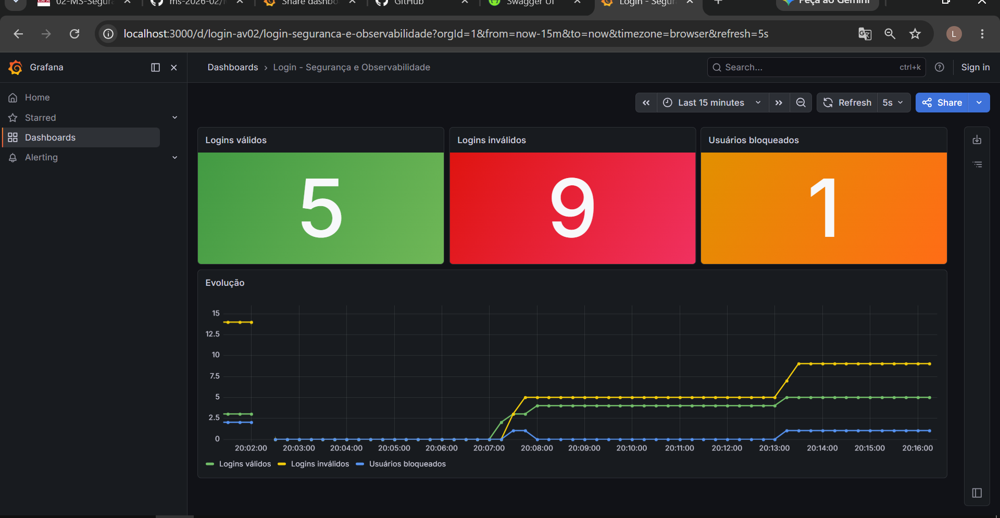

# MS-AV-02 - Segurança e Observabilidade

Serviço de login em Spring Boot 4 (RESTful) com roles via `JdbcUserDetailsManager`, bloqueio por tentativas, métricas no Prometheus, dashboard no Grafana e documentação OpenAPI/Swagger.

## Como executar
```bash
./mvnw spring-boot:run
docker compose up -d
```
- API: http://localhost:8080
- Swagger UI: http://localhost:8080/swagger-ui/index.html (JSON em `/v3/api-docs`)
- Console H2: http://localhost:8080/h2-console (`jdbc:h2:mem:segurancadb`, `sa` / `password`)
- Actuator / métricas: http://localhost:8081/actuator/prometheus
- Prometheus: http://localhost:9090
- Grafana: http://localhost:3000 (`admin` / `admin`, dashboard **Login - Segurança e Observabilidade**)

## Endpoints
| Método | Caminho | Acesso | Retorno |
|---|---|---|---|
| POST | `/login` | público | 200 válido / 401 inválido ou bloqueado |
| PUT | `/trocarsenha/{userid}` | público | 200 / 401 senha atual errada / 404 / 423 bloqueado |
| POST | `/` | `ROLE_MANUTENCAO` | 201 / 409 já existe |
| GET | `/` | `ROLE_MANUTENCAO` | 200 lista de usuários (sem senha) |
| PUT | `/unlock/{userid}` | `ROLE_ADMIN` | 200 / 404 |

Os endpoints protegidos usam HTTP Basic (`-u usuario:senha`).

## Usuários iniciais
| Usuário | Senha | Role |
|---|---|---|
| admin | admin | ROLE_ADMIN |
| admin2 | admin2 | ROLE_ADMIN |
| manutencao | manut | ROLE_MANUTENCAO |
| maria | maria | ROLE_USUARIO |

Há dois admins para que um deles possa desbloquear o outro caso seja bloqueado.

## Bloqueio
Cada falha de login incrementa `failed_attempts` em `login_attempts`. Na segunda falha o usuário é bloqueado (`locked = true`) e desabilitado em `users`, passando a receber 401 mesmo com a senha correta. Um login válido zera as falhas. `PUT /unlock/{userid}` desbloqueia.

## Indicadores
| Métrica Prometheus | Descrição |
|---|---|
| `login_validos_total` | logins válidos |
| `login_invalidos_total` | logins inválidos |
| `usuarios_bloqueados` | usuários bloqueados (lido de `login_attempts`) |

## Dashboard
- Print: `docs/dashboard-grafana.png`
- Exportação: `docs/dashboard-grafana-export.json`
- Provisionamento automático: `monitoring/grafana/dashboards/login-dashboard.json`



## Observações
- A coluna `usuarios.senha` é `VARCHAR(10)` conforme o enunciado, por isso as senhas ficam em texto puro (`{noop}` no Spring Security).
- A vírgula sobrando ao final do `CREATE TABLE login_attempts` do enunciado foi removida.
